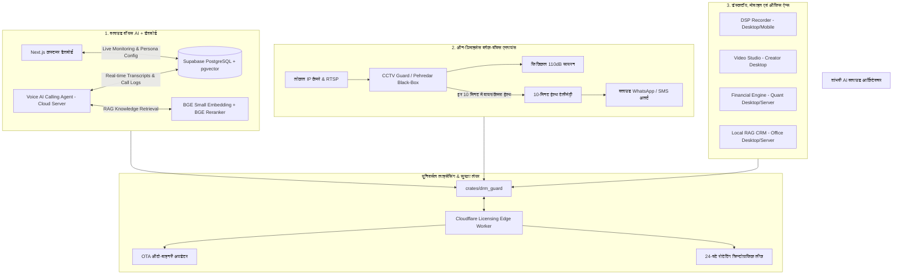

# 🏛️ मास्टर आर्किटेक्चर एवं इम्प्लीमेंटेशन प्लान (Master Implementation Plan)
## Shambhavi AI Labs — Multi-App Cloud Ecosystem & Hardware Licensing Architecture

---

## 📌 1. एक्ज़ीक्यूटिव विज़न एवं सिस्टम वर्गीकरण (Executive Overview)

हमारे सम्पूर्ण इकोसिस्टम में **7 विशिष्ट ऍप्लिकेशन्स** हैं, जिन्हें उनकी प्रकृति, डिप्लॉयमेंट मॉडल और मीटरिंग लॉजिक के आधार पर 3 मुख्य श्रेणियों में विभाजित किया गया है:

---

## 🛠️ 2. ऐप-वार विस्तृत आर्किटेक्चर एवं मीटरिंग प्लान (App Specifications)

### 🎙️ 1. Voice AI Calling Agent (`apps/voice_agent`) — क्लाउड टेलीफ़ोनी + Next.js डैशबोर्ड
- **डिप्लॉयमेंट:** क्लाउड वीपीएस / लिनक्स सर्वर (100% शुद्ध रस्ट बाइनरी, < 150 MB RAM, 0% पायथन).
- **कस्टमर डैशबोर्ड (Next.js):** 
  - ग्राहक को वेब डैशबोर्ड मिलेगा जहाँ वे लाइव कॉल्स, पूर्ण कॉल ट्रांसक्रिप्ट्स, रिकॉर्डिंग्स और कॉल अवधि देख सकेंगे।
  - बॉट का व्यक्तित्व (Persona), प्रॉम्प्ट्स और बिज़नेस रूल्स सेट कर सकेंगे।
- **डेटाबेस व नॉलेज बेस (Supabase):**
  - **PostgreSQL + pgvector:** कंपनी के प्रोडक्ट्स, रेट लिस्ट, FAQs और पॉलिसीज सेव होंगी।
  - **BGE Small Embedding (384-dim) + BGE Small Reranker:** लाइव कॉल के दौरान कॉलर के सवाल का सटीक और सत्य संदर्भ (Ground Truth) सब-15ms में निकाल कर Qwen LLM को देगा।
- **डेटा सिंक:** वॉयस एजेंट सुपबेस से प्रॉम्प्ट/नॉलेज लेगा और हर कॉल का लॉग/ट्रांसक्रिप्ट सुपबेस में पुश करेगा। डैशबोर्ड सुपबेस से लाइव डेटा दिखाएगा।
- **लाइसेंसिंग एवं मीटरिंग:**
  - 24-घंटे का रोटेटिंग क्रिप्टोग्राफिक लीज व ऑटो-अपडेटर।
  - **मीटरिंग लॉजिक:** प्रति कॉल या कॉल मिनट्स (Total Calls Count + Total Call Duration in Minutes).

---

### 🛡️ 2. CCTV Guard / NVR Core (`apps/cctv_guard` & `apps/nvr_core`) — टर्नकी ब्लैक बॉक्स
- **डिप्लॉयमेंट:** ग्राहक की दुकान/शोरूम/बैंक में लगने वाला **कंपनी का समर्पित ब्लैक-बॉक्स हार्डवेयर** (Minimal CPU, 2 GB RAM, SSD).
- **10-मिनट प्रोएक्टिव हेल्थ पिंग (Health Telemetry):**
  - बॉक्स हर 10 मिनट में क्लाउड को हेल्थ पिंग भेजेगा (`{ box_id, cameras_online, wire_status, storage_pct }`).
  - यदि कोई तार ढीला हुआ (Loose Wire), कैमरा ऑफलाइन हुआ या डिस्क 90% भरी, तो क्लाउड तुरंत ग्राहक के मोबाइल पर **WhatsApp / वर्चुअल नंबर SMS** द्वारा अलर्ट भेजेगा।
- **24-घंटे क्रिप्टोग्राफिक लीज (Security Lock):**
  - हर 24 घंटे में बॉक्स क्लाउड से नया क्रिप्टोग्राफिक की (AES-256 Session Key) लेगा।
  - यदि ग्राहक ने पेमेंट रोकी, तो की नहीं मिलेगी, मेमोरी `ZeroizeOnDrop` द्वारा खाली हो जाएगी और बॉक्स की AI प्रोटेक्शन लॉक हो जाएगी।
- **OTA ऑटो-अपडेटर:** नए डिटेक्शन मॉडल और सिक्योरिटी पैच बैकग्राउंड में बिना काम रोके ऑटोमैटिक अपडेट होंगे।
- **मीटरिंग लॉजिक:** सक्रिय कैमरों की संख्या (Active Camera Count: e.g., ₹250/कैमरा/माह).

---

### 🎬 3. Video Studio (`apps/video_studio`) — डेस्कटॉप क्रिएटर ऐप
- **डिप्लॉयमेंट:** यूज़र का साधारण डेस्कटॉप या लैपटॉप (Windows/Mac/Linux), मौजूदा वेबकैम के साथ।
- **कार्य:** वर्चुअल कैमरामैन (PTZ ऑटो-फ्रेमिंग), टेलीप्रॉम्प्टर आई-कॉन्टैक्ट करेक्शन, स्किन स्मूथिंग, 3D LUT ग्रेडिंग।
- **लाइसेंसिंग एवं क्लाउड कनेक्शन:**
  - हर 24 घंटे में क्रिप्टोग्राफिक लीज की लेगा।
  - बैकग्राउंड OTA ऑटो-अपडेटर।
  - 10 मिनट पिंग की ज़रूरत नहीं; केवल 24 घंटे की वेरिफिकेशन।
- **मीटरिंग लॉजिक:** एक्सपोर्ट/रेंडर किए गए वीडियो मिनट्स या एक्सपोर्ट काउंट।

---

### 🎛️ 4. Audio DSP Recorder (`apps/dsp_recorder`) — डेस्कटॉप व मोबाइल ऑडियो ऐप
- **डिप्लॉयमेंट:** यूज़र का साधारण पीसी, लैपटॉप या मोबाइल (Windows/Mac/Linux/Android/iOS).
- **कार्य:** ज़ीरो-लेटेंसी ऑडियो कैप्चर (< 5.3ms), RBJ बाइक्वाड ईक्यू, स्पेक्ट्रल टोन क्लोनिंग, 24-बिट लॉसलेस वेव राइटर।
- **लाइसेंसिंग एवं क्लाउड कनेक्शन:**
  - हर 24 घंटे में क्रिप्टोग्राफिक लीज की लेगा।
  - बैकग्राउंड OTA ऑटो-अपडेटर।
- **मीटरिंग लॉजिक:** रिकॉर्डिंग आवर्स / सक्रिय स्टूडियो सेशंस।

---

### 📈 5. Financial Super Engine (`apps/financial_engine`) — क्वांट व इन्वेस्टर इंजन
- **डिप्लॉयमेंट:** ट्रेडर/इन्वेस्टर का डेस्कटॉप या लोकल सर्वर।
- **कार्य:** 5,000+ कंपनियों का इन-मेमरी एनालिसिस, 100% फ्री पब्लिक डेटा स्क्रेपिंग, डिटरमिनिस्टिक रेश्यो व टेक्निकल मैथ।
- **लाइसेंसिंग एवं क्लाउड कनेक्शन:**
  - हर 24 घंटे में क्रिप्टोग्राफिक लीज की लेगा।
  - बैकग्राउंड OTA ऑटो-अपडेटर।
- **मीटरिंग लॉजिक:** **स्पेशल सर्च एवं डीप वैल्यूएशन स्कैन्स** (ग्राहक जितनी स्पेशल/डीप सर्च करेगा, उसका अलग मीटरिंग चार्ज दर्ज होगा).

---

### 🗄️ 6. Local RAG CRM Vault (`apps/local_rag_engine`) — लोकल ऑफिस RAG
- **डिप्लॉयमेंट:** ऑफिस डेस्कटॉप या लोकल इंट्रानेट सर्वर।
- **कार्य:** PDF/CSV चंकिंग, AES-256-GCM एन्क्रिप्टेड लोकल स्टोर, डायरेक्टML GPU BGE वेक्टर्स, टॉप-K कोसाइन सर्च।
- **लाइसेंसिंग एवं क्लाउड कनेक्शन:**
  - हर 24 घंटे में क्रिप्टोग्राफिक लीज की लेगा।
  - बैकग्राउंड OTA ऑटो-अपडेटर।
- **मीटरिंग लॉजिक:** कुल सर्च क्वेरीज़ और डॉक्युमेंट चंक्स की संख्या।

---

## 📅 3. चरणबद्ध कार्यान्वयन रोडमैप (Implementation Phases)

### चरण 1: मास्टर डॉक्यूमेंटेशन अलाइनमेंट (All 5 Files per App)
- [ ] **`apps/voice_agent`:** `PRD.md`, `MVP.md`, `ARCHITECTURE.md`, `README.md`, `WORK_PROGRESS.md` में क्लाउड डिप्लॉयमेंट, Next.js डैशबोर्ड, सुपबेस pgvector, BGE रीरैंकर, और कॉल मिनट्स मीटरिंग को अपडेट व लॉक करना।
- [ ] **`apps/cctv_guard` & `nvr_core`:** 10-मिनट हेल्थ टेलीमेट्री पिंग, लूज वायर / कैमरा डाउन डिटेक्शन, WhatsApp/SMS अलर्टिंग, और 24-घंटे लीज को सभी 5 फ़ाइलों में अपडेट करना।
- [ ] **`apps/financial_engine`:** स्पेशल सर्च मीटरिंग और 24-घंटे लीज व ऑटो-अपडेटर को दस्तावेज़ों में अलाइन करना।
- [ ] **`apps/video_studio` & `dsp_recorder`:** डेस्कटॉप/मोबाइल 24-घंटे लीज और वीडियो/ऑडियो रेंडरिंग मीटरिंग को स्पष्ट करना।

### चरण 2: `crates/drm_guard` टेलीमेट्री एक्सपेंशन
- [ ] `UsageMetricProvider` में प्रत्येक ऐप के लिए विशिष्ट मेट्रिक्स स्ट्रक्चर जोड़ना:
  - `VoiceAgentMetrics`: `{ calls_completed: u64, total_call_seconds: u64 }`
  - `CctvGuardMetrics`: `{ camera_count: u32, wire_faults: u32, offline_cameras: Vec<String> }`
  - `FinancialMetrics`: `{ special_searches_count: u64, deep_scans_count: u64 }`
  - `RagEngineMetrics`: `{ query_count: u64, chunk_count: u64 }`
  - `VideoStudioMetrics`: `{ render_minutes: f64, exports_count: u32 }`
  - `DspRecorderMetrics`: `{ record_minutes: f64, session_count: u32 }`

### चरण 3: क्लाउडफ्लेयर एज वर्कर एवं सुपबेस स्कीमा सिंक
- [ ] `crates/drm_guard/scripts/universal_licensing_worker.js` में:
  - 10-मिनट टेलीमेट्री एंडपॉइंट (`/api/telemetry/heartbeat-10m`) जोड़ना जो WhatsApp API (Twilio / Meta WhatsApp Business Webhook) को वायर-लूज / कैमरा डाउन होने पर ट्रिगर करे।
  - 24-घंटे का लीज टोकन एंडपॉइंट (`/api/lease/renew-24h`).
- [ ] सुपबेस SQL माइग्रेशन स्क्रिप्ट (`supabase_schema.sql`):
  - `call_logs` टेबल (id, caller_id, duration_sec, sentiment, audio_url, transcript, created_at).
  - `knowledge_documents` टेबल (id, title, content, embedding vector(384)).
  - `agent_config` टेबल (persona_name, system_prompt, greeting, fallback_phone).

### चरण 4: Next.js कस्टमर डैशबोर्ड स्केलेटन (`apps/voice_dashboard`)
- [ ] Next.js 14 ऐप बनाना:
  - लाइव कॉल एक्टिविटी फीड।
  - कॉल ट्रांसक्रिप्ट्स व सर्च बार।
  - नॉलेज बेस अपलोड (PDF / टेक्स्ट ड्रैग-एंड-ड्रॉप)।
  - बिलिंग एवं यूसेज मीटर (कॉल मिनट्स, बचे हुए मिनट्स)।

---

## 🔒 4. स्वीकृति मानदंड (Acceptance Criteria)
1. **शून्य अधूरा कोड:** सभी लॉजिक वास्तविक रस्ट और टाइपस्क्रिप्ट में होंगे।
2. **सख्त 24-घंटे एनफोर्समेंट:** पेमेंट न होने पर RAM सेशन की का शून्य (0) ओवरराइट और ऐप का तुरंत लॉक होना।
3. **प्रोएक्टिव अलर्ट्स:** CCTV का 10-मिनट पिंग फेल या वायर लूज होने पर ऑटोमैटिक WhatsApp नोटिफिकेशन।
4. **सत्यापन:** `cargo check --workspace` 0 एरर और सभी टेस्ट्स 100% पास।
