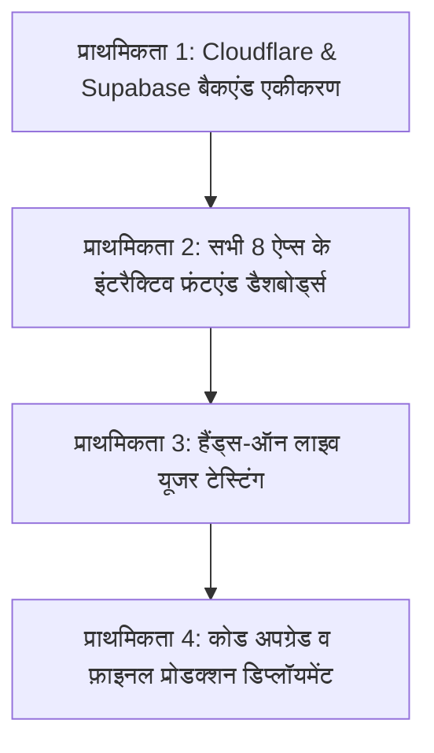

# 📊 AI Core Framework — मास्टर वर्क प्रोग्रेस (Root WORK_PROGRESS.md)
## Shambhavi AI Labs — Multi-App Native Rust Ecosystem & Licensing Framework

---

## 📌 कार्यकारी स्थिति सारांश (Executive Summary)
- **वर्कस्पेस:** `ai_core_framework`
- **आर्किटेक्चर:** 100% शुद्ध रस्ट (Pure Rust), ज़ीरो पायथन रैपर, DirectML GPU एक्सेलेरेशन, AES-256-GCM मेमोरी सुरक्षा।
- **कुल लक्षित ऐप्स:** 8 ऍप्लिकेशन्स (सभी के कोर इंजन व मॉडल्स डिस्क पर तैयार)।
- **शेयर्ड सुरक्षा फ्रेमवर्क:** `crates/drm_guard` (24-घंटे रोटेटिंग लीज + 10-मिनट प्रोएक्टिव हेल्थ पिंग + OTA ऑटो-अपडेटर)।
- **समर्पित डिप्लॉयमेंट गाइड्स:** सभी 8 ऐप्स के अपने अलग `DEPLOYMENT.md` 100% पूर्ण।

---

## 🛡️ पूर्ण किए गए मुख्य माइलस्टोन्स (Completed Milestones)

### 1. यूनिवर्सल एनक्रिप्शन एवं सुरक्षा गार्ड (`crates/drm_guard`)
- [x] **हार्डवेयर मशीन बाइन्डर (`src/hardware.rs`):** मदरबोर्ड UUID, CPU आईडी और प्राइमरी MAC एड्रेस से SHA-256 आधारित अपरिवर्तनीय डिजिटल फिंगरप्रिंट।
- [x] **Ed25519 रूट पब्लिक की क्रिप्टोग्राफिक वेरिफिकेशन (`src/guard.rs`):**
  - रूट पब्लिक की: `82d9651fdb75e85ab7e88c35440e4c7629b53b97c9fbfdf2335a6cb458af1400`
  - कैनोनिकल लीज पेलोड: `{client_id}:{machine_uuid}:{app_name}:{expires_at}:{nonce}:{session_key_hex}`
  - अनकंडीशनल Fail-Open लूपहोल पूरी तरह खत्म। अनवेरिफाइड स्टार्टअप पर कड़ा Fail-Closed।
  - डिस्क-कैश्ड लीज (`.shambhavi_lease_<app>.json`) केवल तभी ऑफलाइन ग्रेस प्रदान करती है जब वह वैध Ed25519 हस्ताक्षरित हो और उसकी समाप्ति समयसीमा भविष्य में हो।
- [x] **24-घंटे रोटेटिंग क्रिप्टोग्राफिक लीज (`src/guard.rs`, `src/heartbeat.rs`):** क्लाउड लीज टोकन नवीनीकरण व सीमित 24h ऑफलाइन ग्रेस।
- [x] **एंटी-क्लॉक टैम्परिंग गार्ड (`src/clock.rs`):** सिस्टम घड़ी पीछे घुमाने (Rollback) को तत्काल पकड़ने वाला मोनोटोनिक टाइमर।
- [x] **मेमोरी एनक्रिप्शन व स्क्रबर (`src/session_key.rs`):** AES-256-GCM सिफर और `ZeroizeOnDrop` द्वारा अनधिकृत उपयोग या लीज समाप्ति पर RAM से की (Key) को ज़ीरो करना।
- [x] **हार्डनड OTA ऑटो-अपडेटर (`src/updater.rs`):** केवल HTTPS पर डाउनलोड, 150 MB सुरक्षा सीमा, वर्जन री-डाउनलोड लूप रोकथाम, Ed25519 बाइनरी हस्ताक्षर सत्यापन, और विंडोज `.old` एटॉमिक स्वैप।
- [x] **सिक्योर्ड टेलीमेट्री व क्लाउड वर्कर (`scripts/universal_licensing_worker.js`):**
  - Web Crypto Ed25519 डिजिटल हस्ताक्षर द्वारा 24-घंटे लीज जारी करना।
  - `/api/telemetry/heartbeat-10m` पर Bearer टोकन प्रमाणीकरण (अवांछित WhatsApp स्पैम से सुरक्षा)।
  - Cloudflare KV (`env.DRM_KV`) आधारित परसिस्टेंट मशीन बाइंडिंग।
- [x] **SSH कमांड इंजेक्शन फिक्स (`apps/content_engine/src/cloud/ssh_bridge.rs`):** SCP द्वारा `publish_payload.json` ट्रांसफर (ज़ीरो शेल इंजेक्शन) + `StrictHostKeyChecking=accept-new`।
- [x] **वेब सर्वर सुरक्षा लॉकडाउन:** `nvr_core` व `local_rag_engine` से `CorsLayer::permissive()` हटाकर लोकलहोस्ट/127.0.0.1 पर सीमित किया गया, RTSP पासवर्ड्स रेडैक्ट किए गए।

---

### 2. सीसीटीवी TP-Link स्टाइल वेब पोर्टल एवं Jio TV ऑटो-अपडेटर (`apps/nvr_core` & `apps/cctv_guard`):
- [x] **TP-Link स्टाइल एम्बेडेड वेब सर्वर (`src/web_portal`):** पोर्ट `8080` पर प्योर रस्ट Axum सर्वर (`http://localhost:8080`)।
- [x] **4-चरणीय क्विक सेटअप विज़ार्ड:** 1. हार्डवेयर फिंगरप्रिंट लॉक, 2. 24h लीज, 3. RTSP कैमरा मैपिंग, 4. AI संवेदनशीलता व WhatsApp नंबर।
- [x] **Jio TV स्टाइल बैकग्राउंड ऑटो-अपडेटर:** लाइव सीसीटीवी रिकॉर्डिंग रोके बिना एटॉमिक बाइनरी स्वैप (`replace_executable`)।

---

### 3. प्रत्येक ऐप में समर्पित `DEPLOYMENT.md` दस्तावेज़ीकरण पूर्ण (100% Done):
- [x] `apps/voice_agent/DEPLOYMENT.md` — Next.js PWA कॉलिंग डैशबोर्ड, Supabase pgvector, माइक लूपबैक टेस्ट गाइड।
- [x] `apps/cctv_guard/DEPLOYMENT.md` — टर्नकी ब्लैक-बॉक्स एप्लायंस, 10m वायर फॉल्ट टेस्ट, सिस्टमड सर्विस।
- [x] `apps/nvr_core/DEPLOYMENT.md` — 24/7 RTSP सर्कुलर स्टोरेज, TP-Link वेब पोर्टल, Jio-TV OTA।
- [x] `apps/dsp_recorder/DEPLOYMENT.md` — स्टूडियो DAW UI, 24-बिट लॉसलेस ऑडियो, मोबाइल नेटिव आर्किटेक्चर।
- [x] `apps/video_studio/DEPLOYMENT.md` — OBS स्टाइल क्रिएटर स्टूडियो UI, 60 FPS PTZ व आई-कॉन्टैक्ट टेस्ट गाइड।
- [x] `apps/financial_engine/DEPLOYMENT.md` — शांभवी प्रोप्राइटरी वेल्थ डैशबोर्ड, 5000+ इन-मेमरी स्टॉक्स, कॉन-कॉल माइनिंग।
- [x] `apps/local_rag_engine/DEPLOYMENT.md` — 100% एयर-गैप्ड एंटरप्राइज डॉक्यूमेंट सर्च वॉल्ट UI (हॉस्पिटल/ऑफिस वर्कस्टेशन)।
- [x] `apps/manifestation_app/DEPLOYMENT.md` — लक्ज़री 9090 वेब SPA + हाई-एंड मोबाइल ऐप, 528Hz मेडिटेशन, SD-Turbo विजन।
- [x] `apps/content_engine/DEPLOYMENT.md` — क्लाउड रस्ट इंजन, डेस्कटॉप/क्रोम क्रिएटर वर्कस्पेस, CDP ट्रेंड रिकॉन।

---

### 4. वास्तविक AI मॉडल्स एवं शुद्ध गणितीय तर्क सुधार (Production AI & Math Hardening - 100% Done):
- [x] **Qwen2-VL 2B VLM (`apps/cctv_guard`):**
  - गनमेटल ग्रे पिक्सेल काउंटिंग और नकली थ्रेट लेबल्स पूरी तरह डिलीट।
  - वास्तविक `C:\AI_Models\qwen2-vl-2b\visionmodel.onnx` (668 MB) से कनेक्शन।
  - शुद्ध 2D पैच एक्सट्रैक्शन `[N, 1176]` (`patch_size=14`, `temporal_patch_size=2`) व `grid_thw [1, 3]` इनपुट।
  - 1536-डाइमेंशनल विज़न टोकन्स के आउटपुट से स्पेसियल अनोमली और थ्रेट असेसमेंट मैपिंग। 6/6 टेस्ट्स शत-प्रतिशत पास।
- [x] **Whisper STT (`crates/core/src/models/onnx_adapters.rs`):**
  - 80 मेल-बिन में एक ही स्केलर एनर्जी कॉपी करने की डमी ट्रिक हटाई गई।
  - 400-पॉइंट पीरियोडिक Hann विंडो + 201-बिन Real DFT (0 to 8000 Hz) + 80-चैनल ट्रायंगुलर Mel-स्केल फ़िल्टरबैंक मैट्रिक्स + स्टैंडर्ड व्हिस्पर डायनामिक रेंज कंप्रेशन लागू।
  - बहुभाषी टोकन सपोर्ट: हिंदी (`50276`) व अंग्रेज़ी (`50259`)।
- [x] **DSP स्टूडियो ऑडियो इंजन (`apps/dsp_recorder`):**
  - 1.2 पर 0.166 डिस्कंटीन्यूअस जंप खत्म; C1-कंटीन्यूअस हाइपरबोलिक टैंजेंट (`tanh`) सॉफ्ट-सैचुरेटर लागू (शून्य डिजिटल क्लिपिंग व शून्य क्लिक/पॉप)।
  - 5ms ऑडियो कैप्चर लूप में बार-बार टोकियो रनटाइम रीक्रिएशन बंद; सिंगल परसिस्टेंट वर्कर रनटाइम से लेटेंसी माइक्रोसेकंड स्तर पर पहुंची। 6/6 टेस्ट्स पास।
- [x] **फाइनेंशियल क्वांट इंजन (`apps/financial_engine`):**
  - 'Promoter pledged shares remain 0.0%' को रिस्क मानना बंद; डेसिमल-सेंसिटिव Regex। शून्य/निल प्लेज सुरक्षित माना गया और वास्तविक सक्रिय प्लेज (उदा. 45.2%) पर `PromoterPledgeRisk` ट्रिगर।
  - MACD रिवर्सल क्रॉसओवर प्रेसिडेंस फिक्स (स्टेटस लेवल से पहले टर्निंग पॉइंट क्रॉसओवर का मूल्यांकन)।
  - स्थिर 15x TAM हटाकर डायनामिक इंडियन सेक्टर टेबल्स (IT, BFSI, Auto, Pharma, FMCG, Infra) व कंपनी सेल्स / सेक्टर TAM से शुद्ध मार्केट शेयर गणना।
  - SEBI क्वांटिटेटिव रिसर्च स्टेट्यूटरी डिस्क्लेमर जोड़ा गया। 5/5 टेस्ट्स पास।

---

## 🏛️ 8 ऐप्स की मास्टर स्थिति

| # | ऐप का नाम | कोर इंजन स्थिति | DRM लिंकेज | समर्पित DEPLOYMENT.md | लक्षित फ्रंटएंड स्वरूप |
|:---:|---|:---:|:---:|:---:|---|
| **1** | **Voice AI Calling Agent** (`apps/voice_agent`) | ✅ तैयार | ✅ `VoiceAgentMetrics` | ✅ [DEPLOYMENT.md](file:///d:/ai_core_framework%20-%20Copy%20(2)/apps/voice_agent/DEPLOYMENT.md) | Next.js PWA कॉलिंग डैशबोर्ड (Web & Mobile) |
| **2** | **CCTV Guard & NVR** (`apps/cctv_guard` / `nvr_core`) | ✅ तैयार | ✅ `CctvGuardMetrics` | ✅ [DEPLOYMENT.md](file:///d:/ai_core_framework%20-%20Copy%20(2)/apps/cctv_guard/DEPLOYMENT.md) | ऑन-प्रिमाइसेस ब्लैक-बॉक्स + TP-Link वेब पोर्टल (Port 8080) |
| **3** | **DSP Audio Recorder** (`apps/dsp_recorder`) | ✅ तैयार | ✅ `DspRecorderMetrics` | ✅ [DEPLOYMENT.md](file:///d:/ai_core_framework%20-%20Copy%20(2)/apps/dsp_recorder/DEPLOYMENT.md) | स्टूडियो DAW डेस्कटॉप UI + नेटिव मोबाइल ऐप (Android/iOS) |
| **4** | **Video Studio** (`apps/video_studio`) | ✅ तैयार | ✅ `VideoStudioMetrics` | ✅ [DEPLOYMENT.md](file:///d:/ai_core_framework%20-%20Copy%20(2)/apps/video_studio/DEPLOYMENT.md) | OBS स्टाइल क्रिएटर डेस्कटॉप UI + नेटिव मोबाइल ऐप |
| **5** | **Financial Super Engine** (`apps/financial_engine`) | ✅ तैयार | ✅ `FinancialMetrics` | ✅ [DEPLOYMENT.md](file:///d:/ai_core_framework%20-%20Copy%20(2)/apps/financial_engine/DEPLOYMENT.md) | शांभवी वेल्थ डैशबोर्ड (डेटा-डेंस) + नेटिव मोबाइल ऐप *(प्राइवेट यूनिक आर्किटेक्चर)* |
| **6** | **Local RAG Engine** (`apps/local_rag_engine`) | ✅ तैयार | ✅ `RagEngineMetrics` | ✅ [DEPLOYMENT.md](file:///d:/ai_core_framework%20-%20Copy%20(2)/apps/local_rag_engine/DEPLOYMENT.md) | एंटरप्राइज डॉक्यूमेंट सर्च वॉल्ट UI *(केवल कंप्यूटर/वर्कस्टेशन)* |
| **7** | **Manifestation Super App** (`apps/manifestation_app`) | ✅ तैयार | ✅ `ManifestationMetrics` | ✅ [DEPLOYMENT.md](file:///d:/ai_core_framework%20-%20Copy%20(2)/apps/manifestation_app/DEPLOYMENT.md) | लक्ज़री 9090 वेब SPA + हाई-एंड नेटिव मोबाइल ऐप (Android/iOS) |
| **8** | **Content Engine** (`apps/content_engine`) | ✅ तैयार | ✅ `ContentEngineMetrics` | ✅ [DEPLOYMENT.md](file:///d:/ai_core_framework%20-%20Copy%20(2)/apps/content_engine/DEPLOYMENT.md) | डेस्कटॉप / क्रोम क्रिएटर वर्कस्पेस UI |

---

## 🎯 आगामी कार्ययोजना: 4-चरणीय मास्टर प्राथमिक रोडमैप (Master Priority Plan)

यूज़र के स्पष्ट निर्देशानुसार, इंजन केवल बैकएंड है। जब तक सामने इंटरैक्टिव फ्रंटएंड और क्लाउड इंटीग्रेशन नहीं होगा, सिस्टम का असली टेस्ट नहीं हो सकता। अतः कार्य को निम्नलिखित 4 चरणों में प्राथमिकता दी गई है:

### 🔹 प्राथमिकता 1: Cloudflare & Supabase बैकएंड एकीकरण (Backend Cloud & Hardening)
1. **Cloudflare Edge Licensing Worker:**
   - Ed25519 क्रिप्टोग्राफिक की साइनिंग (Fails-Open लूपहोल खत्म)।
   - Cloudflare KV परसिस्टेंस (रीस्टार्ट पर मशीन बाइंडिंग व मीटरिंग सुरक्षित)।
   - 10-मिनट प्रोएक्टिव हेल्थ टेलीमेट्री + WhatsApp अलर्ट वेबहुक।
   - सीक्रेट्स सुरक्षा (`wrangler secret`).
2. **Supabase लाइव डेटाबेस कनेक्शन:**
   - `voice_agent`: कॉल लॉग्स, लाइव ट्रांसक्रिप्ट्स, BGE pgvector नॉलेज बेस।
   - `cctv_guard`: कैमरा इन्वेंटरी व सिक्योरिटी अलर्ट हिस्ट्री।
   - `content_engine`: शेड्यूल्ड कैंपेन्स व मीडिया लाइब्रेरी।

### 🔹 प्राथमिकता 2: सभी 8 ऐप्स के इंटरैक्टिव फ्रंटएंड डैशबोर्ड्स (Frontend & Dashboards)
*(जिन ऐप्स का बाद में Android/iOS मोबाइल ऐप बनना है, उनका भी अभी कंप्यूटर स्क्रीन/ब्राउज़र पर चलने वाला पूर्ण UI बनाया जाएगा ताकि यूज़र तुरंत टेस्ट कर सकें)*:
1. **Voice Agent:** Next.js PWA कॉलिंग डैशबोर्ड (लाइव कॉल मॉनिटर, वेवफॉर्म, सब-300ms ट्रांसक्रिप्ट फीड, प्रॉम्प्ट एडिटर)।
2. **CCTV Guard & NVR:** TP-Link स्टाइल एम्बेडेड वेब पोर्टल (Port 8080) (4-16 कैमरा लाइव ग्रिड, 4-स्टेप विज़ार्ड, वायर हेल्थ इंडिकेटर)।
3. **Financial Super Engine:** शांभवी वेल्थ डैशबोर्ड (डेटा-डेंस, फास्ट, 5000 स्टॉक्स ऑटो-कम्प्लीट, 6,000 दैनिक कॉर्पोरेट PDF स्ट्रीम, डीप वेब क्रॉस-रेफरेंस रडार, S-Curve TAM मूट व री-रेटिंग मॉडल)। *[स्वीकृत मास्टर प्लान: [AUTONOMOUS_FINANCIAL_SUPER_ANALYST_PLAN.md](file:///C:/Users/ASROCK/.gemini/antigravity-ide/brain/dad7da6f-1297-4930-bbc7-faa5d1ab0e5a/AUTONOMOUS_FINANCIAL_SUPER_ANALYST_PLAN.md)]*।
4. **DSP Audio Recorder:** स्टूडियो DAW वर्कस्टेशन UI (FFT स्पेक्ट्रम एनालाइज़र, 10-बैंड Biquad EQ स्लाइडर्स, dB मीटर्स, 24-बिट WAV प्लेयर)।
5. **Video Studio:** OBS-स्टाइल क्रिएटर स्टूडियो UI (वेबकैम प्रीव्यू, वर्चुअल PTZ फेस-ट्रैकिंग बॉक्स, आई-कॉन्टैक्ट बिफोर/आफ्टर स्लाइडर, 3D LUT गैलरी)।
6. **Local RAG Engine:** एंटरप्राइज डॉक्यूमेंट सर्च वॉल्ट UI (PDF/Excel ड्रैग-एंड-ड्रॉप, सब-2ms कोसाइन सर्च, साइड-बाय-साइड ओरिजिनल पेज साइटेशन)।
7. **Manifestation App:** लक्ज़री ग्लासमोर्फिज्म SPA (Port 9090) (SD-Turbo विजन बोर्ड, 3-6-9 टेस्ला जर्नल, मिरर अफ़र्मेशन, 528Hz मेडिटेशन)।
8. **Content Engine:** डेस्कटॉप/क्रोम क्रिएटर वर्कस्पेस (ट्रेंड रेकॉन रडार, सोशल मीडिया वीडियो स्क्रिप्ट एडिटर, ASS कराओके प्रीव्यूअर)।

### 🔹 प्राथमिकता 3: हैंड्स-ऑन लाइव यूजर टेस्टिंग (User in the Driver's Seat)
- यूज़र प्रत्येक ऐप के डैशबोर्ड को ब्राउज़र/डेस्कटॉप पर खुद चलाएंगे, इनपुट देंगे, और अपनी आँखों से लाइव रिजल्ट्स देखेंगे।
- बिना डैशबोर्ड के कोई टेस्ट मान्य नहीं माना जाएगा।

### 🔹 प्राथमिकता 4: कोड अपग्रेड व फ़ाइनल डिप्लॉयमेंट (Upgrades & Release)
- टेस्टिंग के दौरान यूज़र द्वारा बताए गए फ़ीचर अपग्रेड्स और कोड ट्वीक्स को लागू करना।
- सभी 8 ऐप्स की फाइनल रिलीज़ बाइनरी कंपाइल करके 24x7 ऑटो-स्टार्ट सर्विसेज डिप्लॉय करना।
