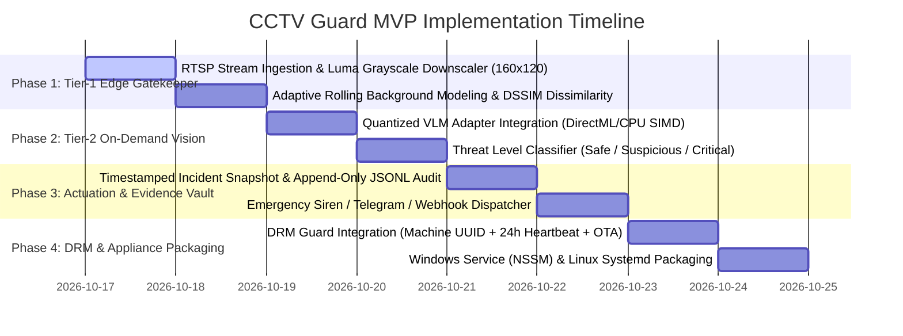

# 🚀 Minimum Viable Product (MVP) Roadmap
## Proactive AI CCTV Guard Appliance (`apps/cctv_guard`)

---

## 📌 Executive MVP Scope

The **Minimum Viable Product (MVP)** delivers an edge-native, two-tier AI CCTV security appliance built in 100% pure Rust. It operates 24/7 on ultra-low-cost hardware (Minimal Dual-Core/Celeron CPU, 2 GB RAM, SSD) without discrete GPUs or cloud dependencies, continuously filtering multi-channel RTSP streams at <5% CPU and waking up local quantized vision models only on true anomalies.

---

## 🗺️ Multi-Phase Implementation Roadmap

---

## 🧪 MVP Verification & Test Matrix

| Component | Target Verification | Expected Pass Criteria |
| :--- | :--- | :--- |
| **RTSP Gatekeeper** | Multi-camera 1080p RTSP stream processing | CPU utilization strictly $<5\%$; memory baseline $<80\text{ MB}$; 0 dropped frames. |
| **DSSIM Motion Filter** | Distinguish subtle human motion from rain/shadows | Zero false triggers on shadows or headlights; $>98\%$ detection on physical breaches. |
| **On-Demand VLM** | Awakens local model only when motion gate trips | Cold-to-inference latency $<800\text{ ms}$; outputs structured JSON classification. |
| **Evidence Writer** | Disk write test during simultaneous alarm triggers | Clean JPEG frame saved with JSON metadata; atomic disk flush. |
| **DRM Subscription** | 24-hour lease expiry & clock rollback simulation | Revokes session instantly on tamper; disables camera monitoring loop. |
| **Hardware Envelope** | Stress test on minimal 2 GB RAM machine | System stable for 24+ hours; zero memory leaks or unbounded queues. |

---

## 🏁 MVP Launch Acceptance Criteria
1. Full workspace compilation: `cargo check -p cctv_guard` with **0 errors**.
2. Operates seamlessly on **Minimal CPU, 2 GB RAM, and SSD** with ultra-low power consumption.
3. Zero recurring cloud inference costs; 100% self-contained on edge premises.
4. Auto-recovers from camera disconnection and network drops without requiring manual restarts.
