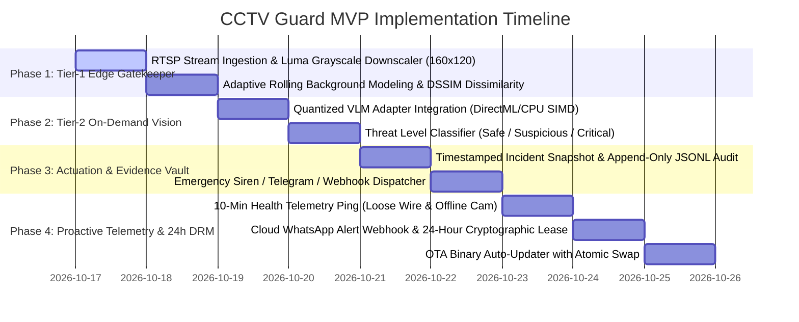

# 🚀 Minimum Viable Product (MVP) Roadmap
## Proactive AI CCTV Guard Appliance (`apps/cctv_guard`)

---

## 📌 Executive MVP Scope

The **Minimum Viable Product (MVP)** delivers an edge-native, two-tier AI CCTV security appliance built in 100% pure Rust for our turnkey Black-Box units. It operates 24/7 on ultra-low-cost hardware (Minimal Dual-Core/Celeron CPU, 2 GB RAM, SSD) without discrete GPUs or cloud dependencies, continuously filtering multi-channel RTSP streams at <5% CPU, transmitting **10-minute proactive health telemetry pings** (triggering WhatsApp alerts on loose cables or offline cameras), protected by **24-hour cryptographic subscription leases** and automated OTA binary updates.

---

## 🗺️ Multi-Phase Implementation Roadmap

---

## 🧪 MVP Verification & Test Matrix

| Component | Target Verification | Expected Pass Criteria |
| :--- | :--- | :--- |
| **RTSP Gatekeeper** | Multi-camera 1080p RTSP stream processing | CPU utilization strictly $<5\%$; memory baseline $<80\text{ MB}$; 0 dropped frames. |
| **DSSIM Motion Filter** | Distinguish subtle human motion from rain/shadows | Zero false triggers on shadows or headlights; $>98\%$ detection on physical breaches. |
| **On-Demand VLM** | Awakens local model only when motion gate trips | Cold-to-inference latency $<800\text{ ms}$; outputs structured JSON classification. |
| **10-Min Health Ping** | Disconnected camera or physical wire disconnect | Pings Cloudflare every 10 mins; dispatches WhatsApp notification to owner in $<5\text{s}$. |
| **24-Hour DRM Lease** | Expired lease / non-payment simulation | Session key zeroized in RAM; AI detection halts; prompt for renewal. |
| **OTA Auto-Updater** | Version bump and update deployment | Verifies SHA-256 hash; atomic binary swap completes seamlessly. |

---

## 🏁 MVP Launch Acceptance Criteria
1. Full workspace compilation: `cargo check -p cctv_guard` with **0 errors**.
2. Operates seamlessly on **Minimal CPU, 2 GB RAM, and SSD** with ultra-low power consumption.
3. 10-minute proactive telemetry reliably detects camera drops and dispatches WhatsApp alerts.
4. 24-hour cryptographic subscription leasing fully integrated with `crates/drm_guard`.
