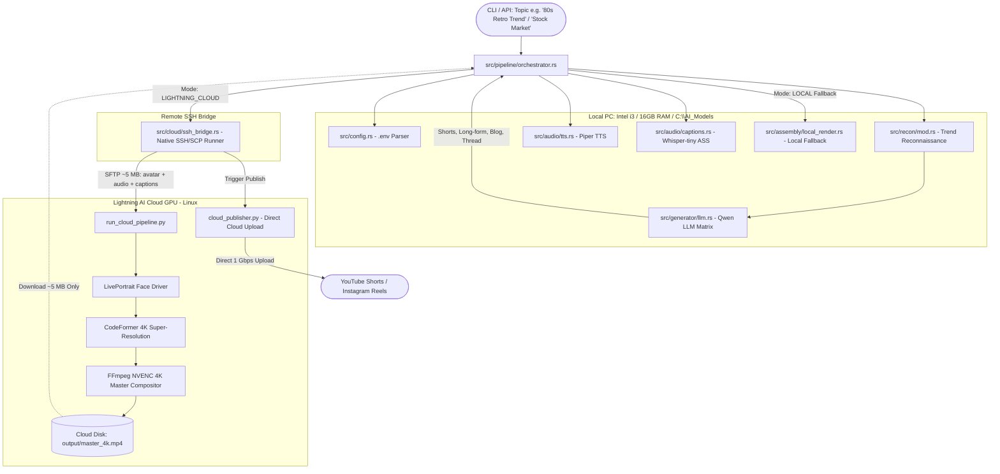

# 🏛️ Technical Architecture Blueprint
## Universal Autonomous Content & Media Engine (`apps/content_engine`)
**8th Autonomous App & Cross-App Integration — Shambhavi AI Labs**  
**Architect:** Sandeep Udasi  

---

## 1. High-Level Architectural Diagram



---

## 2. Module Directory Structure

```
apps/content_engine/
├── Cargo.toml
├── PRD.md
├── MVP.md
├── ARCHITECTURE.md
├── README.md
├── WORK_PROGRESS.md
└── src/
    ├── lib.rs                      # Public library exports
    ├── main.rs                     # CLI entry point
    ├── config.rs                   # Unified .env and config parser
    ├── recon/                      # Module 8A: Universal Trend Reconnaissance
    │   ├── mod.rs
    │   ├── youtube.rs              # YouTube competitor & hook scraper
    │   ├── social.rs               # Instagram / TikTok / Twitter trend pulse
    │   ├── web_rss.rs              # Google News, Reddit, arXiv in-depth RSS
    │   └── dossier.rs              # Structured Trend Dossier builder
    ├── generator/                  # Omnichannel Content Generation
    │   ├── mod.rs
    │   ├── prompts.rs              # Hook formulas & system prompts
    │   ├── omnichannel.rs          # 4-format asset synthesizer
    │   └── visual_cues.rs          # Timestamps & B-roll prompt mapper
    ├── audio/                      # Audio & Captions
    │   ├── mod.rs
    │   ├── tts.rs                  # Piper TTS engine
    │   └── captions.rs             # Whisper-tiny word-level ASS generator
    ├── cloud/                      # Lightning AI SSH Remote Engine
    │   ├── mod.rs
    │   ├── ssh_bridge.rs           # Native OpenSSH command and file runner
    │   ├── worker_generator.rs     # Generates remote Python scripts
    │   └── direct_publisher.rs     # Remote cloud publishing trigger
    └── assembly/                   # Video Compositing & Video Studio Integration
        ├── mod.rs
        ├── gaze_integrator.rs      # video_studio GazeCorrector hook
        ├── lut_integrator.rs       # video_studio 3D LUT hook
        └── local_render.rs         # Local FFmpeg fallback renderer
```

---

## 3. Data Models & Schemas

### 3.1 Trend Dossier Schema
```rust
pub struct TrendDossier {
    pub topic: String,
    pub timestamp: String,
    pub top_competitors: Vec<CompetitorVideo>,
    pub viral_hooks: Vec<String>,
    pub reverse_engineered_tools: Vec<String>,
    pub key_facts: Vec<String>,
    pub sentiment: String,
}

pub struct CompetitorVideo {
    pub title: String,
    pub view_count: u64,
    pub hours_ago: u64,
    pub view_velocity: f32, // Views per hour
    pub hook_transcription: Option<String>,
}
```

### 3.2 Omnichannel Content Package
```rust
pub struct OmnichannelPackage {
    pub topic: String,
    pub short_script: ShortVideoScript,
    pub long_script: String,
    pub blog_article: String,
    pub twitter_thread: Vec<String>,
}

pub struct ShortVideoScript {
    pub hook: String,
    pub body_lines: Vec<ScriptLine>,
    pub cta: String,
}

pub struct ScriptLine {
    pub text: String,
    pub visual_cue: String,
    pub timestamp_sec: f32,
}
```

---

## 4. Hardware Resource Isolation Policy
1. **CPU:** Multithreading capped to 4 intra-op threads for local ONNX inference.
2. **RAM:** Total process memory bounded under 4 GB.
3. **GPU (Local):** AMD RX 550 used only for DirectML when available; automatic graceful fallback to CPU.
4. **Cloud GPU:** High-VRAM diffusion and 4K super-resolution offloaded to NVIDIA A10G/T4 on Lightning AI.

---

## 5. Supabase Cloud Media Matrix Subsystem (`src/supabase.rs`)
- **Database Engine:** Supabase PostgreSQL Cloud (Project `hbnwmjrrhvpibtqsucqz`).
- **Master Tables:**
  1. `public.content_pieces`: Stores synthesized 60s shorts, 1200w SEO articles, YouTube long scripts, Twitter threads, word counts, and media URLs.
  2. `public.publishing_logs`: Tracks multi-platform syndication across YouTube, Twitter (X), LinkedIn, and blogs.
  3. `public.trend_dossiers`: Stores reconnaissance intelligence, competitor benchmark velocity, and viral hooks.
- **Auto-Sync:** `ContentEngineOrchestrator::execute_campaign` automatically synchronizes all generated assets to Supabase Cloud upon pipeline completion.
