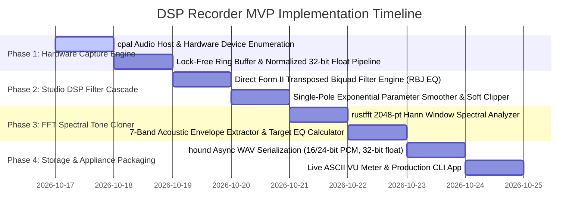

# 🚀 Minimum Viable Product (MVP) Roadmap
## Audio DSP Recorder & Tone Cloner Studio (`apps/dsp_recorder`)

---

## 📌 Executive MVP Scope

The **Minimum Viable Product (MVP)** provides a zero-latency, professional-grade audio processing, recording, and acoustic tone cloning engine built in 100% pure Rust. Designed for podcasters, voice artists, and content creators, it runs as a native cross-platform application on standard desktop computers, laptops, and mobile devices (Windows, macOS, Linux, Android, iOS) with sub-5.3ms latency, < 30 MB RAM usage, and zero dedicated hardware purchase required.

---

## 🗺️ Multi-Phase Implementation Roadmap

---

## 🧪 MVP Verification & Test Matrix

| Component | Target Verification | Expected Pass Criteria |
| :--- | :--- | :--- |
| **Biquad Filters** | RBJ Audio EQ math stability test across sweeps | Finite coefficients; zero numerical blowup or NaN outputs. |
| **Filter Processing** | 1 kHz sine wave filtering & harmonic shaping | Attenuation and boost precisely match filter curve; zero phase tearing. |
| **Parameter Smoother** | Step gain change from 0 dB to +12 dB | Exponential convergence across buffer windows; zero audible zipper noise. |
| **FFT Tone Cloner** | 7-band spectral analysis on reference vocal | Frequency bounds cleanly separated; delta gains computed accurately. |
| **WAV Serialization** | 24-bit PCM lossless write & readback test | Byte-for-byte fidelity preserved; valid WAV header generated. |
| **Hardware Envelope** | Live recording on minimal 2 GB RAM system | Memory usage strictly $<30\text{ MB}$; CPU load $<2\%$. |

---

## 🏁 MVP Launch Acceptance Criteria
1. All 6 automated tests in `tests/dsp_tests.rs` pass with **100% green status**.
2. Zero dropped audio samples or buffer underruns at 128/256 sample buffer frames.
3. Clean compilation: `cargo check -p dsp_recorder` with **0 errors**.
4. Single static binary execution requiring no external DLLs or Python runtime.
