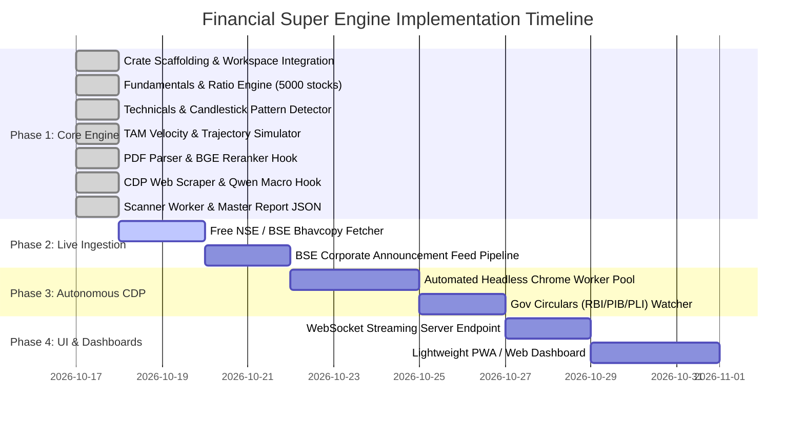

# 🚀 MVP Execution Plan & Implementation Roadmap
## Pure Rust Financial Super Engine (`apps/financial_engine`)

---

## 📌 Executive Summary
The **Minimum Viable Product (MVP)** demonstrates an autonomous, zero-Python financial analysis engine executing deterministic fundamental analysis, technical candlestick pattern recognition, TAM growth velocity modeling, PDF filing extraction, and native CDP web scraping across a 5,000-stock database in under 50ms.

---

## 🗺️ Multi-Phase Implementation Roadmap

---

## 🧪 Phase 1: Verification Matrix (COMPLETED & VERIFIED)

| Test Item | Verification Method | Pass Criteria | Status |
| :--- | :--- | :--- | :--- |
| **Workspace Compilation** | `cargo check --workspace` | Exit code 0, 0 errors, 0 warnings | ✅ **PASSED** |
| **Crate Compilation** | `cargo check -p financial_engine` | Exit code 0, 0 errors, 0 warnings | ✅ **PASSED** |
| **In-Memory DashMap DB** | Unit test `test_stock_database_in_memory` | Lock-free insert, retrieve, ROCE > 50% | ✅ **PASSED** |
| **Technical Calculations** | Unit test `test_technical_calculations` | RSI-14, MACD, Bollinger, Score >= 5.0 | ✅ **PASSED** |
| **TAM Simulation** | Unit test `test_tam_simulation_engine` | 5-year projections, CAGR > 15%, Score >= 8.0 | ✅ **PASSED** |
| **PDF Regex Extraction** | Unit test `test_regex_extraction` | Capex, Order Book, Plant Expansion matched | ✅ **PASSED** |
| **Report Latency** | `cargo run -p financial_engine` | Full report synthesized in **$< 50\text{ ms}$** | ✅ **PASSED** |

---

## 🛠️ Phase 2: Free Public Data Feed Ingestion (Next Up)

1. **Daily NSE Bhavcopy & Delivery Position Ingestion:**
   - Pure Rust HTTP download of daily free CSV bhavcopy from public endpoints.
   - Batch updating all 5,000+ stock OHLCV records in the `StockDatabase` within 2 seconds.
2. **BSE XBRL & Corporate Action Feed:**
   - Parsing live corporate announcements from the official BSE RSS feeds.
   - Triggers automatic PDF extraction when an announcement includes investor presentations or quarterly earnings transcripts.

---

## 🌐 Phase 3: Headless Chrome CDP Live Feed

1. **Autonomous Headless Chrome Pool:**
   - Using `chromiumoxide` to keep 1 headless tab active on standby for scraping news updates without cold-start browser launch penalty.
2. **Local AI Reasoning:**
   - Streaming text to local `QwenLocal` (`C:\AI_Models\qwen2-vl-2b`) to classify news into sector-specific impact tables.

---

## 🖥️ Phase 4: Web / PWA Dashboard Frontend

1. **Local Axum/Tokio HTTP & WebSocket Server:**
   - Exposing `GET /api/stocks/:ticker` -> Returns `MasterStockReport` in $< 50\text{ ms}$.
   - WebSocket `/api/stream/alerts` -> Pushes real-time `OutlierAlert` events as they trigger from `scanner.rs`.
2. **Institutional Dark-Mode PWA:**
   - Clean, lightweight charting with zero third-party telemetry, 100% self-hosted.

---

## 🛡️ Phase 5: 24-Hour Cryptographic Lease, OTA Auto-Updater & Special Search Metering

1. **24-Hour Rotating Lease:**
   - Background worker connects to `crates/drm_guard` and Cloudflare licensing endpoint.
   - Requires valid 24-hour cryptographic session key; zeroizes volatile memory upon non-payment.
2. **Special Search & Deep Scan Metering:**
   - Telemetry tracks each deep valuation calculation, multi-year DCF simulation, and volume outlier scan (`special_searches_count`, `deep_scans_count`).
3. **OTA Binary Auto-Updater:**
   - Cryptographic SHA-256 validation with atomic binary swapping for zero-downtime background updates.

