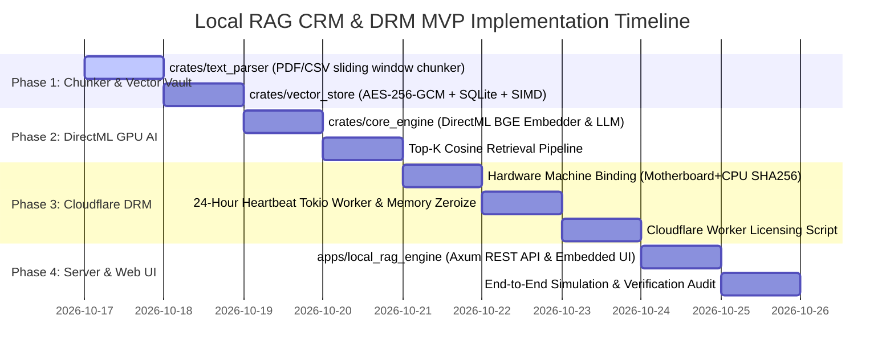

# 🚀 Minimum Viable Product (MVP) Roadmap
## Native Rust Local RAG CRM & DRM Appliance (`apps/local_rag_engine`)

---

## 📌 Executive MVP Scope

The **Minimum Viable Product (MVP)** delivers a production-grade, self-hosted document search and customer interaction intelligence engine operating under 150ms on standard Windows office PCs, backed by a 24-hour Cloudflare cryptographic lease.

---

## 🗺️ Multi-Phase Implementation Roadmap

---

## 🧪 MVP Verification & Test Matrix

| Component | Target Verification | Expected Pass Criteria |
| :--- | :--- | :--- |
| **Document Chunker** | Parse 10-page business PDF and 1,000-row CSV | Chunks created in 300–500 word windows with 50-word overlap; zero data loss. |
| **AES-256-GCM Store** | Encrypt 10,000 text chunks with 32-byte key | Plaintext unreadable in SQLite; authenticates and decrypts only with valid session key. |
| **DirectML GPU Pipeline** | Generate 384-dim embeddings on GPU | DirectX 12 adapter initialized; $< 3\text{ ms}$ per chunk embedding latency. |
| **In-Memory Cosine Index** | Query across 50,000 vectors | Top-5 relevant matches returned in $< 2\text{ ms}$ with exact source citations. |
| **24-Hour DRM Lockout** | Expired lease / tampered clock simulation | Session key zeroized from RAM; vector search locked; renewal QR code displayed. |
| **Axum Web Server** | Concurrent REST API query testing | 100 concurrent requests served in $< 150\text{ ms}$ average response time. |

---

## 🏁 MVP Launch Acceptance Criteria
1. `cargo check --workspace` must exit with **0 errors and 0 warnings**.
2. All unit tests across `text_parser`, `vector_store`, and `local_rag_engine` must pass with **100% green status**.
3. Memory consumption must strictly stay below **350 MB RAM** during 10,000-document ingestion.
4. The system must operate with **0% Python** and **zero cloud API dependencies** for local document intelligence.
