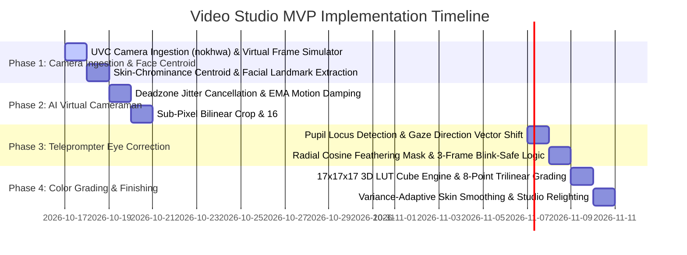

# 🚀 Minimum Viable Product (MVP) Roadmap
## AI Video Studio & Virtual Cameraman (`apps/video_studio`)

---

## 📌 Executive MVP Scope

The **Minimum Viable Product (MVP)** provides a real-time desktop video enhancement studio built in 100% pure Rust. It equips solo creators and remote professionals with an autonomous AI cameraman (PTZ auto-framing), teleprompter eye contact correction, skin smoothing, and cinematic 3D LUT grading. The entire pipeline executes locally on standard consumer PCs and laptops (Windows, macOS, Linux) with sub-8ms frame processing, $<120\text{MB}$ RAM, and zero dedicated hardware purchase required.

---

## 🗺️ Multi-Phase Implementation Roadmap

---

## 🧪 MVP Verification & Test Matrix

| Component | Target Verification | Expected Pass Criteria |
| :--- | :--- | :--- |
| **Virtual Camera Simulator** | 60 FPS synthetic video feed injection | Consistent frame delivery; zero dropped frames in headless test runs. |
| **Face Tracking & PTZ** | Subject motion across frame with abrupt stops | Deadzone prevents micro-jitter; fluid EMA damping simulates fluid-head tripod. |
| **Gaze Warping** | Off-axis downward teleprompter reading angle | Gaze redirected toward lens; zero border tearing or robotic stare artifacts. |
| **Blink Protection** | Fast eyelid blink sequence | Correction intensity decays smoothly to 0; no distorted eyelids. |
| **3D LUT Grading** | Full-frame color grading with built-in presets | Accurate trilinear interpolation; latency strictly $<3\text{ ms}$ per frame. |
| **Hardware Footprint** | Continuous streaming on 2 GB RAM system | Memory usage strictly $<120\text{ MB}$; runs smoothly on minimal dual-core CPU. |

---

## 🏁 MVP Launch Acceptance Criteria
1. Automated test suite in `tests/` passes with **100% green status**.
2. Real-time 30 FPS processing on standard 720p/1080p webcam input.
3. Clean workspace check: `cargo check -p video_studio` with **0 errors**.
4. 100% self-hosted, offline operation without third-party cloud API calls or Python runtimes.
