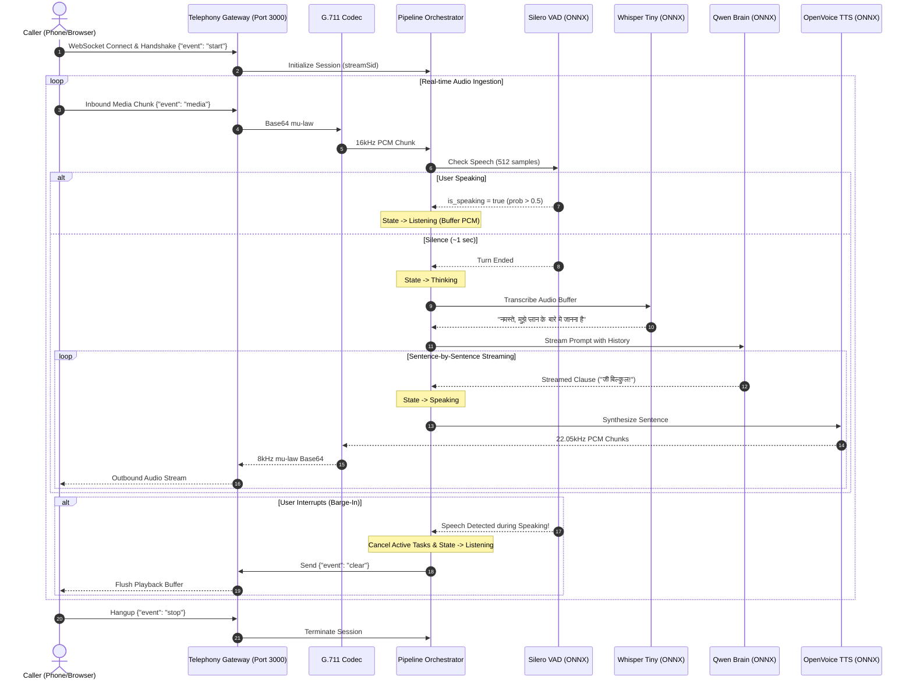

# 🎙️ Voice AI Calling Agent Architecture (`apps/voice_agent`)

## 1. High-Level Overview
The **Voice AI Calling Agent** (`apps/voice_agent`) is an enterprise-grade, real-time, full-duplex conversational voice application built on top of the `ai_core` framework. It bridges standard telephony networks (Twilio, Exotel, Plivo) or web browser WebSockets with local neural AI models to achieve human-parity conversational latencies (**< 300ms**).

Operating completely on local hardware with zero external cloud APIs, the agent handles audio companding, speech detection, transcription, reasoning, neural speech generation, and bidirectional streaming.

```
                      +---------------------------------------+
                      | Telephony Provider / Web Test Client  |
                      | (Twilio, Exotel, Browser Microphone)  |
                      +---------------------------------------+
                                          |
                      Bidirectional WebSocket (Port 3000)
                      JSON Media Protocol (G.711 mu-law, 8kHz)
                                          |
                                          v
+-----------------------------------------------------------------------------------+
|                        VOICE AI CALLING AGENT PIPELINE                            |
|                                                                                   |
|  +-----------------------------------------------------------------------------+  |
|  |                 1. Telephony Gateway (`src/telephony.rs`)                   |  |
|  |  - Axum WebSocket server at `ws://0.0.0.0:3000/ws/telephony`                |  |
|  |  - Decodes base64 G.711 mu-law audio packets from incoming JSON             |  |
|  |  - Enqueues outbound synthesized audio frames back to the client            |  |
|  +-----------------------------------------------------------------------------+  |
|                                         |                                         |
|                                         v                                         |
|  +-----------------------------------------------------------------------------+  |
|  |                     2. Audio Codec (`src/codec.rs`)                         |  |
|  |  - G.711 mu-law <-> 16-bit Linear PCM Conversion                           |  |
|  |  - 8kHz (Telephony) <-> 16kHz (AI Models) Upsampling / Downsampling         |  |
|  +-----------------------------------------------------------------------------+  |
|                                         |                                         |
|                                         v                                         |
|  +-----------------------------------------------------------------------------+  |
|  |               3. Pipeline Orchestrator (`src/pipeline.rs`)                  |  |
|  |                                                                             |  |
|  |  [State Machine]  Idle (0) <-> Listening (1) <-> Thinking (2) <-> Speaking (3) |  |
|  |                                                                             |  |
|  |  +-------------------+   +--------------------+   +----------------------+  |  |
|  |  | Silero VAD Local  |   | Whisper Tiny Local |   |      Qwen Local      |  |  |
|  |  | 32ms speech check |-->| Real ONNX STT      |-->| ChatML LLM Brain     |  |  |
|  |  | Turn-end detect   |   | Greedily decoded   |   | Sentence stream      |  |  |
|  |  +-------------------+   +--------------------+   +----------------------+  |  |
|  |                                                              |              |  |
|  |                                                              v              |  |
|  |  +-------------------+   +--------------------+   +----------------------+  |  |
|  |  | Instant Barge-In  |   | Multi-turn Memory  |   |   OpenVoice Local    |  |  |
|  |  | CancellationToken |   | Session history    |   |   Neural TTS Stream  |  |  |
|  |  | "clear" buffer    |   | Dynamic Persona    |   |   1024-byte chunks   |  |  |
|  |  +-------------------+   +--------------------+   +----------------------+  |  |
|  +-----------------------------------------------------------------------------+  |
+-----------------------------------------------------------------------------------+
```

---

## 2. Core Subsystems

### A. Telephony Gateway (`src/telephony.rs`)
The Telephony Gateway manages persistent bidirectional WebSocket connections compatible with the Twilio Media Streams and Exotel Audio Streaming specifications:
- **WebSocket Endpoint:** `ws://0.0.0.0:3000/ws/telephony`
- **Protocol Events Handled:**
  - `start`: Extracts `streamSid` and session metadata, then initializes a dedicated `PipelineOrchestrator` instance.
  - `media`: Extracts base64-encoded G.711 $\mu$-law audio payload, decodes it into raw bytes, and delivers it to the pipeline via `inbound_audio_tx`.
  - `stop`: Triggers graceful call teardown and releases GPU/RAM session state.
- **Outbound Transmission:** Encodes synthesized PCM audio into $\mu$-law, wraps it in base64 within a JSON frame (`{"event": "media", "streamSid": "...", "media": {"payload": "..."}}`), and pushes it across the socket.
- **Buffer Flushing:** On barge-in interruption, emits `{"event": "clear", "streamSid": "..."}` to tell the carrier/browser to immediately silence currently buffered audio.

---

### B. Audio Codec & DSP Bridge (`src/codec.rs`)
Telephony networks operate on 8kHz 8-bit $\mu$-law (G.711u), whereas speech AI models require 16kHz 16-bit linear PCM:
- **Decompanding ($\mu$-law $\to$ Linear PCM):** Uses a precomputed 256-entry lookup table to expand 8-bit non-linear $\mu$-law samples into signed 16-bit PCM values in $O(1)$ time.
- **Resampling:** Upsamples incoming 8kHz samples to 16kHz for Silero VAD and Whisper STT using linear interpolation with anti-aliasing. Downsamples outbound 16kHz/22.05kHz neural audio to 8kHz for carrier compliance.
- **Companding (Linear PCM $\to$ $\mu$-law):** Compresses 16-bit signed samples back into 8-bit $\mu$-law bytes for transmission over the network.

---

### C. Pipeline Orchestrator (`src/pipeline.rs`)

#### 1. Atomic State Machine
Tracks conversational turn states with atomic sequential consistency (`AtomicUsize`):
* `0`: **Idle** — Call connected, awaiting audio activity.
* `1`: **Listening** — User is speaking; audio buffer is actively accumulating.
* `2`: **Thinking** — User stopped speaking; Whisper STT and Qwen LLM are reasoning.
* `3`: **Speaking** — OpenVoice TTS is generating neural speech and transmitting audio to the caller.

#### 2. Turn-Taking & Sliding-Window VAD Loop
* Audio is analyzed in 512-sample (32ms) increments using `SileroVadLocal`.
* When speech probability exceeds threshold (`prob > 0.5`), the agent transitions into `Listening` and buffers raw PCM.
* Silence counter monitors consecutive non-speech chunks. When silence persists for **~20 consecutive chunks (~640ms - 1000ms)**, the user's turn is marked as complete and buffered audio is dispatched to Whisper STT.

#### 3. Sentence-by-Sentence Streaming Hand-off
To prevent latency buildup, the agent avoids waiting for the LLM to complete its entire response:
1. Qwen LLM streams tokens into a sentence accumulator.
2. When a sentence boundary is detected (`.`, `?`, `!`, `।`, or newline):
3. The complete clause is immediately handed off to `OpenVoiceLocal::synthesize_stream`.
4. Synthesized PCM chunks are continuously streamed to the telephony socket while the LLM generates the next sentence.

#### 4. Instant Barge-In (Interruption Handling)
If the caller begins speaking while the agent is in the `Speaking` state:
1. `vad.process_chunk()` detects human speech (`prob > 0.5`).
2. `handle_barge_in()` is immediately invoked.
3. The active `CancellationToken` is cancelled, terminating active LLM generation and TTS synthesis routines.
4. An `{"event": "clear", "streamSid": "..."}` message is sent to the telephony socket to clear the carrier's playback buffer.
5. The state flips back to `Listening`, and speech buffering resumes without losing incoming audio.

#### 5. Contextual Memory & Persona (`src/prompts.rs`)
* The orchestrator maintains an active session history: `history: Arc<Mutex<Vec<(String, String)>>>`.
* Past turns are included in ChatML prompts to ensure contextual coherence across multi-turn exchanges.
* System prompts define the agent's identity, language preferences (Hindi/Hinglish/English), and conversational constraints.

#### 6. Answering Machine Detection (AMD) & Voicemail Cutoff
* The STT transcript is scanned for automated IVR cues ("leave a message", "voicemail", "beep", "record your message").
* If detected, the orchestrator transmits `{"event": "mark", "mark": {"name": "hangup"}}` and terminates the call immediately, saving telephony carrier minutes.

---

## 3. End-to-End Latency Budget (< 300ms)

```
[User Stops Speaking]
       |
       +---> [VAD Turn Completion Detect]        : ~32ms
       |
       +---> [Whisper Tiny Q4 STT ONNX]          : ~80 - 110ms
       |
       +---> [Qwen2-VL ONNX Time-to-First-Token] : ~90 - 120ms
       |
       +---> [Piper TTS First Audio Chunk]       : ~40 - 60ms
       |
[Audio Hits Telephony Provider Buffer]           : Total <= 250 - 300ms
```

---

## 4. End-to-End Call Lifecycle Sequence Diagram



---

## 5. Supabase Cloud PostgreSQL CRM Subsystem (`src/supabase.rs`)
- **Database Engine:** Supabase PostgreSQL Cloud (Project `kbrfcrhioqdnhznkpseb`).
- **CRM Tables:**
  1. `public.leads`: 10,000+ lead queue with state machine (`pending`, `in_progress`, `scheduled_callback`, `meeting_booked`, `not_interested`, `dnd`).
  2. `public.call_logs`: Whisper STT turn-by-turn transcript JSONB, Qwen LLM concise business summary, customer intent, sentiment, disposition.
  3. `public.scheduled_callbacks`: Precision callback engine (e.g. *tomorrow 4:00 PM*).
  4. `public.meeting_bookings`: Strategic 30-minute meetings with calendar integration.
  5. `public.action_tickets`: Refund requests, AMC SLA claims, and policy clause citations.
- **Fail-Closed Persistence:** All calls logged locally as audit JSON, and synced via async connection pooling to Supabase Cloud with sub-5ms indexed queries.

