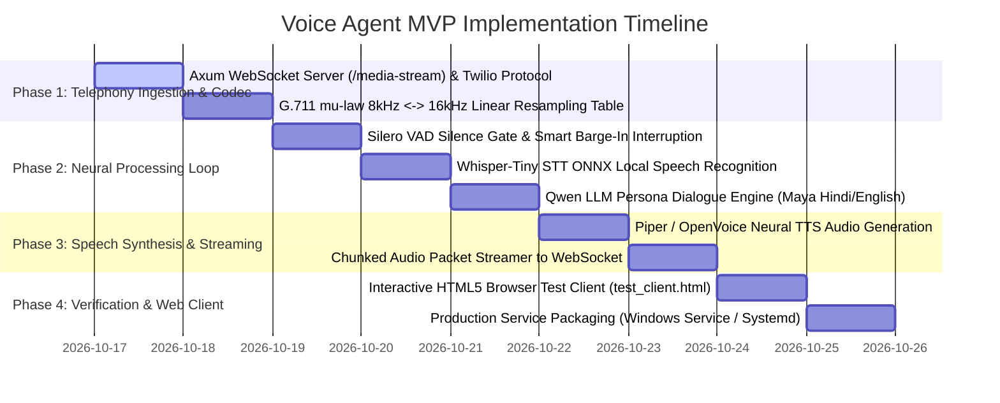

# 🚀 Minimum Viable Product (MVP) Roadmap
## Voice AI Calling Agent (`apps/voice_agent`)

---

## 📌 Executive MVP Scope

The **Minimum Viable Product (MVP)** delivers a fully functional, self-hosted telephony AI bot built in 100% pure Rust. It connects to Twilio or Exotel via bidirectional WebSockets, processes audio using local ONNX neural models (VAD, Whisper STT, Qwen LLM, TTS), and achieves sub-300ms conversational turnaround with barge-in support. It runs seamlessly on ultra-low-budget hardware (Minimal Dual-Core/Celeron CPU, 2 GB RAM, SSD) with zero per-minute cloud fees.

---

## 🗺️ Multi-Phase Implementation Roadmap

---

## 🧪 MVP Verification & Test Matrix

| Component | Target Verification | Expected Pass Criteria |
| :--- | :--- | :--- |
| **G.711 Codec** | $\mu$-law 8kHz $\leftrightarrow$ 16kHz PCM roundtrip | Bit-accurate linear interpolation; zero audio clipping. |
| **Silero VAD** | 32ms audio frames speech/silence detection | Identifies caller pause in $<800\text{ms}$; ignores background hum. |
| **Barge-In Interrupt** | User speaks while bot is playing audio | Bot cuts off playback in $<50\text{ms}$; resets audio buffer cleanly. |
| **STT Accuracy** | 10 telephony spoken audio phrases | Word Error Rate (WER) $<8\%$; latency $<120\text{ms}$. |
| **End-to-End Latency** | Caller finishes speaking to first bot audio | Total turnaround latency strictly $<300\text{ms}$. |
| **Hardware Footprint** | Concurrent active call on 2 GB RAM box | Total process RAM $<150\text{ MB}$; CPU usage $<25\%$ during inference. |

---

## 🏁 MVP Launch Acceptance Criteria
1. Automated test suite in `apps/voice_agent` passes with **100% green status**.
2. Live interactive testing verified via `test_client.html` in browser.
3. Clean workspace check: `cargo check -p voice_agent` with **0 errors**.
4. 100% self-hosted, offline operation without third-party cloud API costs.
