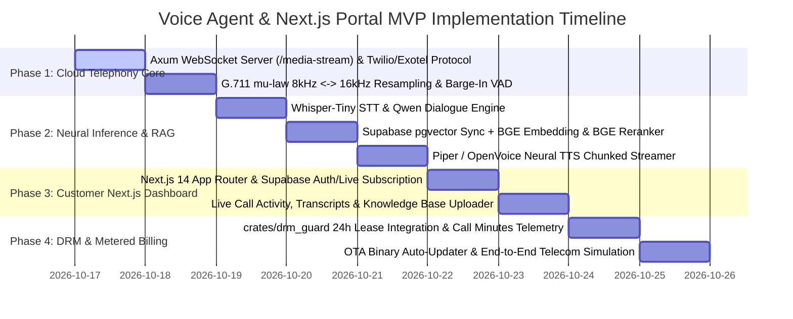

# 🚀 Minimum Viable Product (MVP) Roadmap
## Cloud Voice AI Calling Agent & Next.js Management Portal (`apps/voice_agent`)

---

## 📌 Executive MVP Scope

The **Minimum Viable Product (MVP)** delivers an enterprise-ready, cloud-hosted conversational voice AI service built in 100% pure Rust, coupled with a **Next.js Customer Analytics Dashboard** and a **Supabase (PostgreSQL + pgvector)** knowledge store. It handles inbound and outbound telephone calls with sub-300ms turnaround, grounded in real-time company knowledge via local **BGE Small Embeddings** and **BGE Small Reranker**. The engine is protected by a 24-hour rotating cryptographic lease (`crates/drm_guard`), background OTA auto-updater, and metered billing on call duration and call volume.

---

## 🗺️ Multi-Phase Implementation Roadmap

---

## 🧪 MVP Verification & Test Matrix

| Component | Target Verification | Expected Pass Criteria |
| :--- | :--- | :--- |
| **G.711 Codec** | $\mu$-law 8kHz $\leftrightarrow$ 16kHz PCM roundtrip | Bit-accurate linear interpolation; zero audio clipping. |
| **Silero VAD** | 32ms audio frames speech/silence detection | Identifies caller pause in $<800\text{ms}$; ignores background hum. |
| **Barge-In Interrupt** | User speaks while bot is playing audio | Bot cuts off playback in $<50\text{ms}$; resets audio buffer cleanly. |
| **Supabase pgvector RAG** | Retrieve matching company FAQ during call | Sub-15ms Top-K retrieval via BGE Small Embedding & Reranker; zero hallucinations. |
| **Next.js Dashboard** | Live call display & transcript sync | Web UI updates via Supabase Realtime in $<200\text{ms}$; displays active call minutes. |
| **DRM 24h Lease** | Expired lease / unpaid client simulation | Session key zeroized in RAM; telephony server rejects inbound SIP connections. |
| **OTA Auto-Updater** | Background binary version check & swap | Atomic binary swap applies cleanly without interrupting active calls. |

---

## 🏁 MVP Launch Acceptance Criteria
1. Automated test suite in `apps/voice_agent` passes with **100% green status**.
2. Live interactive testing verified via `test_client.html` and Next.js portal.
3. Clean workspace check: `cargo check -p voice_agent` with **0 errors**.
4. Full telemetry integration reporting calls completed and call duration in minutes.
