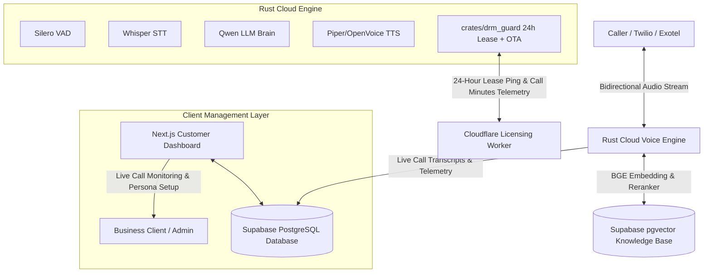

# 📋 Product Requirements Document (PRD): Cloud Voice AI Calling Agent & Next.js Portal (`voice_agent`)

## 1. Executive Summary & Problem Statement
Customer support centers, lead generation agencies, and outbound appointment desks struggle with heavy staff turnover, high call handling costs, and human error. Traditional voice bots rely on brittle Python wrappers chained with third-party cloud APIs (OpenAI, Deepgram, ElevenLabs), causing high conversational latency (>1.5–3.0s), steep per-minute fees ($0.15–$0.30/min), and vendor lock-in.

**`voice_agent`** is a high-performance, 100% native Rust, cloud-deployed conversational telephony service coupled with a modern **Next.js Customer Analytics Dashboard** and a **Supabase (PostgreSQL + pgvector)** persistence layer:
1. **Cloud-Native Telephony Engine:** Deployed on cloud servers / Linux containers, handling concurrent inbound and outbound SIP/WebSocket calls via Twilio, Exotel, or generic telephony gateways.
2. **Sub-300ms Conversational Turnaround:** Zero heavy Python runtime. Executes Silero VAD, Whisper STT, Qwen LLM, and Piper/OpenVoice neural TTS directly on-device/cloud instance.
3. **Supabase + pgvector & Neural RAG Knowledge:** Integrated with Supabase PostgreSQL using `pgvector`, indexed with local **BGE Small Embedding** (384-dim) and **BGE Small Reranker** for real-time sub-15ms business knowledge retrieval during live phone conversations.
4. **Customer Next.js Management Dashboard:** Full-featured web portal for business clients to monitor live calls, view call recordings and transcripts, configure agent personas, upload knowledge base documents, and track usage.
5. **Universal DRM & Metered Usage Licensing:** Integrated with `crates/drm_guard` for 24-hour rotating cryptographic lease verification, background OTA binary auto-updates, and metered billing tracking **total calls executed and call duration in minutes**.

---

## 2. System Architecture & Component Interaction

---

## 3. Core Functional Requirements

### 3.1 Cloud Telephony Engine & Protocols
- **Axum WebSocket Ingestion:** Listens on `/media-stream` accepting Twilio Media Streams, Exotel, and generic VoIP WebSockets.
- **ITU-T G.711 $\mu$-law Codec:** Precomputed 256-entry lookup table decoding 8kHz telephony streams into 16kHz PCM with linear interpolation and zero audio clipping.
- **Smart Barge-In (Interruption):** Continuously runs Silero VAD on 32ms frames; instantly terminates outgoing TTS speech synthesis within $<50\text{ms}$ when caller interrupts.

### 3.2 Supabase Vector Knowledge Base & RAG Retrieval
- **Supabase PostgreSQL + pgvector:** Stores company products, FAQs, pricing, and business operating rules.
- **BGE Small Embeddings:** Generates dense 384-dimensional vector embeddings for domain context chunks.
- **BGE Small Reranker:** Executes cross-encoder reranking on top vector candidates, injecting only high-confidence ground truth into the Qwen LLM prompt.
- **Zero Hallucination:** Agent strictly speaks from retrieved Supabase context; politely declines unknown queries.

### 3.3 Customer Next.js Dashboard
- **Live Call Overview:** Active calls, completed calls, average duration, and sentiment scores.
- **Transcript & Audio Explorer:** Searchable call transcripts synced in real-time from Supabase with audio playback.
- **Knowledge Base Manager:** Drag-and-drop PDF/text document upload that automatically chunks, embeds via BGE, and stores in `pgvector`.
- **Persona & Script Customizer:** Edit system instructions, greeting messages, bot name, and fallback escalation phone numbers.

### 3.4 24-Hour Cryptographic Lease, OTA Auto-Updates & Metering
- **24-Hour Lease:** Pings Cloudflare Worker every 24 hours. Overwrites session keys with `0` via `ZeroizeOnDrop` if payment lapses.
- **Metered Usage Telemetry:** Submits `UsageMetrics` reporting **total calls completed** and **cumulative call minutes** to Cloudflare during heartbeats.
- **OTA Binary Auto-Updater:** Checks for updates during heartbeats, verifies SHA-256 hashes, and applies atomic binary swaps without interrupting active calls.

---

## 4. Platform & Deployment Specifications

- **Deployment Model:** Cloud Server / VPS (Ubuntu Server 22.04 LTS / Docker container / AWS EC2 / Hetzner).
- **Resource Footprint:** Lightweight native binary consuming $< 200\text{ MB}$ RAM on standard 2-core / 2GB cloud instances.
- **Database:** Supabase Cloud or Self-Hosted Supabase instance (PostgreSQL 15+ with `vector` extension).
- **Frontend Stack:** Next.js 14+ (App Router, TailwindCSS / Vanilla CSS, Supabase JS SDK, Lucide Icons).
- **Licensing:** Managed via `crates/drm_guard` with automated 24-hour token refresh and Over-The-Air auto-updater.
